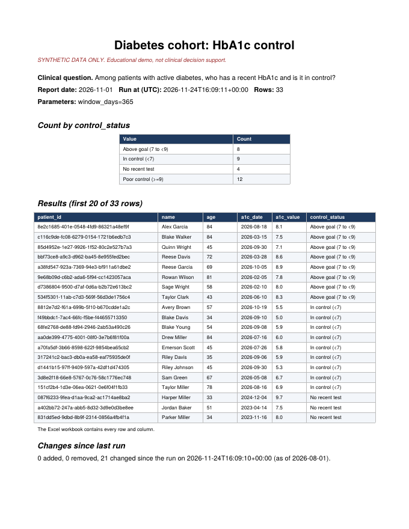

# report-automation-kit

Parameterised SQL cohort reports to a formatted **Excel workbook** and a **PDF summary**, with
**run history** and a **"what changed since the last run"** diff. Built on synthetic,
Synthea-style data. It is the same job as building a recurring report in a hospital query tool,
written as code so it is versioned, tested and repeatable.

> **Synthetic data only.** Educational demo. The thresholds are illustrative, not clinical
> guidelines, and nothing here is clinical decision support. Never point it at real patient data.



Sample outputs from a real run are committed in [`examples/`](examples/) (PDF and Excel for each
report).

## Quick start

```bash
python -m venv .venv
.venv\Scripts\Activate.ps1            # Windows PowerShell  (Linux/macOS: source .venv/bin/activate)
pip install -e ".[dev]"

report-kit generate-data --out data   # synthetic Synthea-style CSVs (deterministic, --seed 7)
report-kit run --data data --out out  # all reports -> out/*.xlsx and out/*.pdf
report-kit run --data data --out out --as-of 2026-11-01   # run again for a different date
report-kit history --out out          # every run so far
```

Run it twice with different `--as-of` dates (or after the data changes) and the second run reports
what was added, removed or changed since the first, in the PDF, in the Excel `Changes` sheet and
on the console.

## The three example reports

| Report | Clinical question |
|---|---|
| `diabetes_cohort` | Among patients with active diabetes, who has a recent HbA1c, and is it in control? |
| `medication_safety` | Who is on active metformin with no creatinine or eGFR result in the lookback window? |
| `noshow_summary` | How many appointments were fulfilled, missed or cancelled each month? |

Cohort definitions, code lists, parameters and limitations: [docs/reports.md](docs/reports.md).

## How it works

```
CSV folder ──> SQLite (in memory) ──> report .sql + parameters ──> rows
                                                                    ├─> Excel (Summary / Data table / Changes)
                                                                    ├─> PDF   (summary, top rows, changes, limitations)
                                                                    └─> history.db  ──> diff on the next run
```

- A report is one `.sql` file with a small header (title, clinical question, key column, default
  parameters, limitations). Add your own with `--reports-dir`.
- Parameters are bound, never string-formatted: `:as_of` plus whatever the report declares
  (override with `--param window_days=180`).
- Missing tables give a clear error naming the report and the table.

## Scheduling

The CLI is a plain command, so any scheduler works. Examples (adjust paths):

```bash
# Linux/macOS cron: 06:00 on the 1st of every month
0 6 1 * *  cd /path/to/report-automation-kit && .venv/bin/report-kit run --data data --out out
```

```powershell
# Windows Task Scheduler (run once in PowerShell to create the task)
schtasks /Create /SC MONTHLY /D 1 /ST 06:00 /TN "report-kit" /TR "cmd /c cd /d D:\path\to\report-automation-kit && .venv\Scripts\report-kit.exe run --data data --out out"
```

`history.db` accumulates every run, so each scheduled run is diffed against the previous one.

## Tests

```bash
pytest
```

30 tests run the SQL against a tiny hand-built database where every expected answer can be checked
by eye: cohort membership, "latest result, not worst", threshold boundaries (exactly 7.0 and 9.0),
the lookback-window edge, results dated after the report date being ignored, stopped medications,
resolved conditions, the diff (added / removed / changed), the Excel and PDF structure (including
zero-row reports) and the CLI end to end.

## Honest limitations

- **SQLite, not DuckDB.** The plan suggested DuckDB; this uses SQLite (built into Python, nothing
  to install). The SQL is standard apart from a few date functions, so a DuckDB engine is a small
  change but has not been done or tested.
- **Synthea-shaped, not yet run on a real Synthea download.** Table and column names follow
  Synthea's CSV export (`patients`, `conditions`, `observations`, `medications`); the generator
  here is what the tests and examples use. Trying it on a real export is the obvious next step.
- **Synthea has no appointment data.** The `appointments` table (and so the no-show report) is a
  synthetic extension produced by `generate-data`. On a real Synthea export that report stops with
  a clear "table not found" message.
- Small code lists, illustrative thresholds, no exclusions, no age or sex logic. See the report
  docs.
- The PDF shows at most 20 rows and 7 columns; the Excel file has everything.
- The Windows Task Scheduler command is provided as a template and has not been run on a real
  scheduler.

## Layout

```
src/report_kit/   cli.py  catalog.py  db.py  synth.py  history.py  xlsx.py  pdf.py  sql/*.sql
tests/            hand-built fixture + reports, history/exports, CLI/generator
docs/reports.md   cohort definitions and limitations
examples/         sample Excel + PDF outputs
```

## License

MIT, see [LICENSE](LICENSE).
